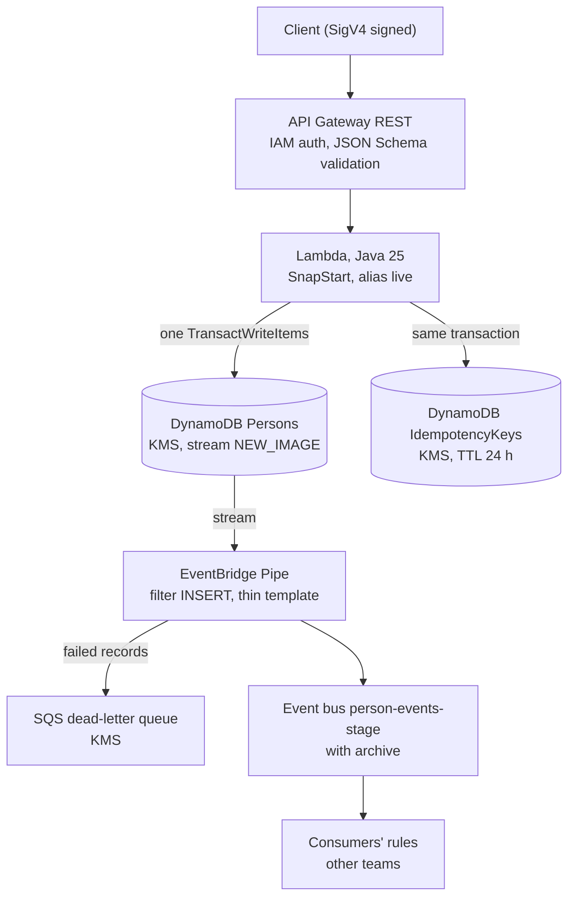

# Person Service

A serverless AWS service: `POST /person` stores a person in DynamoDB and publishes a thin `PersonCreated` event to EventBridge. Java 25 Lambda with SnapStart, infrastructure in AWS CDK for Java.

## Architecture

The Lambda makes one write and never calls EventBridge. The event is derived from the stream ([ADR 0001](docs/adr/0001-outbox-via-streams-and-pipes.md)). Stack wiring is in `infra/src/main/java/com/tikkie/person/infra/PersonServiceStack.java`.

## Documentation

- [Architecture decisions](docs/architecture-decisions.md): the design at a glance, with an ADR for each decision ([index](docs/adr/README.md))
- [API contract](docs/api.md): request, responses and problem types
- [Build, test and deploy](docs/development.md)
- [Operations](docs/operations.md): event pipeline runbook, alarms, scaling
- [Trade-offs, risks and privacy](docs/risks-and-privacy.md)
- [Status and roadmap](docs/roadmap.md)
- [Event schema](docs/events/person-created.v1.json) and the original [brief](docs/plan.md)
