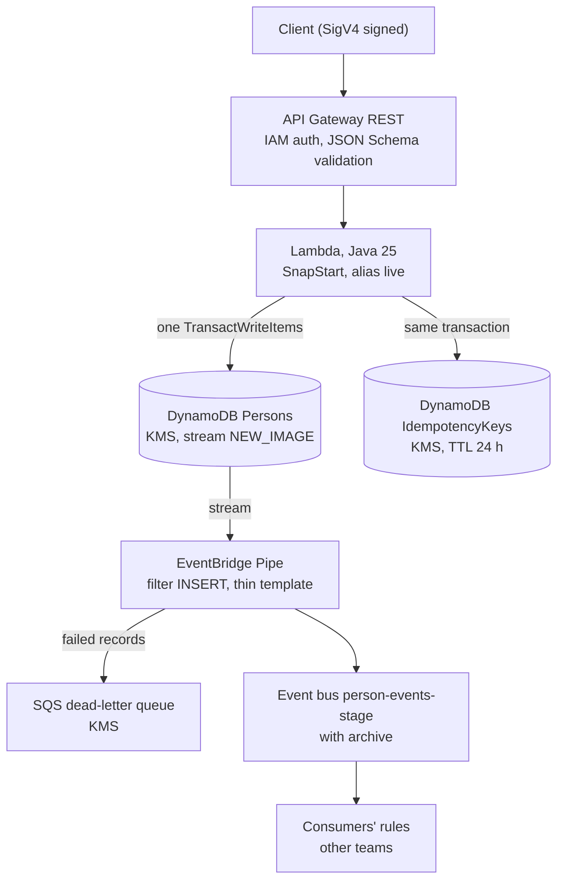

# Person Service

A serverless AWS service that registers a person through one REST endpoint and publishes a `PersonCreated` event. Java 25 Lambda, DynamoDB, EventBridge, infrastructure in AWS CDK for Java.

The one endpoint is `POST /person`. It stores a first name, last name, phone number and address, and the event that follows carries only the person's id.

## Architecture decisions

This section is the design at a glance, and it is kept current. Every change to a decision updates this table, its ADR and [`docs/plan.md` §13](docs/plan.md) in the same pull request. The brief's original decisions are 1–8. Rows marked **(added)** or **(refines N)** were decided with the owner during delivery. The one-line index is [docs/adr/README.md](docs/adr/README.md).

| # | Decision | Why | Rejected alternative | ADR |
|---|----------|-----|----------------------|-----|
| 1 | Derive `PersonCreated` from the DynamoDB stream through an EventBridge Pipe (outbox through change data capture) | The table write is the only write. Every committed insert produces an event, and the Lambda has no publishing code. | Lambda writes the person, then calls `PutEvents`: a partial failure leaves a person without an event | [0001](docs/adr/0001-outbox-via-streams-and-pipes.md) |
| 2 | Thin event: `personId` and metadata, no PII | Personal data never leaves the service, GDPR erasure stays possible, and consumers decide what they need | Fat event carrying the whole person | [0002](docs/adr/0002-thin-event.md) |
| 3 | Synchronous `201 Created` | The client gets the id and validation errors immediately | API → SQS → Lambda with `202` | [0003](docs/adr/0003-synchronous-created.md) |
| 4 | Idempotency through an `Idempotency-Key` header and one DynamoDB transaction (person and key) | Retries are safe, and a duplicate never reaches the stream, so it never produces a duplicate event | Powertools idempotency (needs AspectJ); payload hashing as the key | [0004](docs/adr/0004-idempotency-key-and-transaction.md) |
| 5 | REST API (v1). API Gateway validates the body against the schema. The handler alone enforces `Idempotency-Key`, case-insensitively | JSON Schema request validation, IAM auth, per-stage throttling | HTTP API (no body validation) | [0005](docs/adr/0005-rest-api.md) |
| 6 | IAM (SigV4) authentication | Service-to-service, no secrets to manage | API keys; Cognito | [0006](docs/adr/0006-iam-authentication.md) |
| 7 | One CDK Stage per environment; every difference lives in `EnvironmentConfig` | Same template for every environment, no name collisions | Copy-pasted stacks per environment | [0007](docs/adr/0007-one-stage-per-environment.md) |
| 8 | Java 25 with SnapStart, behind a `live` alias | The requested language; SnapStart removes most of the JVM cold start | Node/TypeScript Lambda | [0008](docs/adr/0008-java-and-snapstart.md) |
| 9 | **(refines 4)** Idempotency keys are scoped per caller, using the IAM principal with the STS session stripped | Two callers sharing a key must not get each other's 422 or person id | Global keys; full-session scope (breaks retries from a new session) | [0009](docs/adr/0009-per-caller-idempotency-scope.md) |
| 10 | **(refines 4)** Request fingerprint: SHA-256 over a canonical form, behind a port | No per-request cost or extra dependency. Swapping in an HMAC later changes one class | KMS HMAC per request: cost, latency and a new failure point (on the roadmap) | [0010](docs/adr/0010-request-fingerprint.md) |
| 11 | **(refines 4)** Write semantics: cancellations branch on reason codes, transient ones back off over 3 attempts, the key window is a fixed 24 h, and `ClientRequestToken` is the candidate id | No spurious 500s under bursts, a deterministic expiry, and a lost-response retry that still reports a fresh create | Retry once without backoff; treating any stored key as valid forever | [0011](docs/adr/0011-idempotent-write-semantics.md) |
| 12 | **(added)** `415` for non-JSON bodies | API Gateway skips body validation for content types that have no mapped model | `400 malformed`; relying on API Gateway alone | [0012](docs/adr/0012-unsupported-media-type.md) |
| 13 | **(added)** Exactly three unavoidable IAM wildcards (X-Ray writes, the log-group stream suffix, KMS prefix actions on the stage key), enforced by a test | Tracing and CMK encryption require them. Any other wildcard fails the build | Managed policies that hide the same `*`; turning tracing off | [0013](docs/adr/0013-iam-wildcard-exceptions.md) |
| 14 | **(added)** The stack sets the account-level API Gateway logging role and retains it. This is accepted for the assessment, so deploy into a dedicated account | Access logging needs it, and a fresh account would otherwise fail to deploy | An account prerequisite (manual step); disabling access logs | [0014](docs/adr/0014-account-level-apigateway-logging-role.md) |

## Architecture



The Lambda makes one write and never calls EventBridge. The event is derived from the stream ([ADR 0001](docs/adr/0001-outbox-via-streams-and-pipes.md)). Stack wiring is in `infra/src/main/java/com/tikkie/person/infra/PersonServiceStack.java`.

## Request and response contract

Request: headers `Content-Type: application/json` and `Idempotency-Key: <UUID>` (required), optional `X-Correlation-Id`. Body: `firstName`, `lastName`, `phoneNumber`, and `address` with `street`, `houseNumber`, `postalCode`, `city`, `countryCode` and an optional `houseNumberAddition`. Schema: `infra/src/main/java/com/tikkie/person/infra/constructs/PersonRequestModel.java`. Example body and rules: `docs/plan.md` §5.1 and §5.3.

| Status | When | Problem type |
|--------|------|--------------|
| 201 | Created. `Location: /person/{personId}`, body `personId` and `createdAt`. | none |
| 201 | Replay of the same key and the same request. Same body, header `Idempotent-Replayed: true`. | none |
| 400 | Domain validation failed, with a list of field errors, or the body is unreadable, or the `Idempotency-Key` header is missing or not a UUID (the handler checks it, whatever the header's casing). | `/problems/validation-error`, `/problems/malformed-request` |
| 400 | API Gateway rejected the body against the schema. This body comes from API Gateway, not the service. | none |
| 415 | `Content-Type` is not `application/json` ([ADR 0012](docs/adr/0012-unsupported-media-type.md)). | `/problems/unsupported-media-type` |
| 422 | Same key used with a different request. | `/problems/idempotency-key-reused` |
| 500 | Unexpected failure. Body has the correlation ID, no stack trace and no input. | `/problems/internal-error` |

Problem bodies follow RFC 9457 and are built in `service/src/main/java/com/tikkie/person/adapter/in/api/ProblemDetails.java`. Every response carries `X-Correlation-Id`.

## Trade-offs and accepted risks

| Risk | What we accepted and why | Where |
|------|--------------------------|-------|
| SHA-256 fingerprint | The fingerprint is a plain hash of low-entropy personal data. Someone with read access to the IdempotencyKeys table could brute-force it offline. Limited by the 24 h TTL, KMS encryption and least-privilege IAM. A KMS HMAC would add a call, cost and a failure point to every create, so it is a roadmap item and a one-class swap. | [0010](docs/adr/0010-request-fingerprint.md) |
| Account-level logging role | The stack sets the API Gateway CloudWatch Logs role for the whole account and region, and retains it. Deploying into a shared account replaces other APIs' role. Deploy into a dedicated account. | [0014](docs/adr/0014-account-level-apigateway-logging-role.md) |
| IAM wildcards | Three: X-Ray write actions on `*` (no resource-level support), the function's own log group with its `:*` stream suffix, and KMS `ReEncrypt*` and `GenerateDataKey*` on one key. A test fails on any other wildcard. `grant*` also gives more DynamoDB actions than the code uses. A fourth exception is the AWS managed policy on the API Gateway logging role. | [0013](docs/adr/0013-iam-wildcard-exceptions.md), [0014](docs/adr/0014-account-level-apigateway-logging-role.md) |
| Clock skew at 24 h | Lambda clocks differ by under a second. In that window two concurrent identical requests can both create a person: one sees the key as live, the other as expired. Stored `expiresAt` is whole seconds, so the window is 24 h minus up to 999 ms. | [0011](docs/adr/0011-idempotent-write-semantics.md) |
| Conflict path testing | DynamoDB Local serialises transactions, so the race loser always sees `ConditionalCheckFailed`. The concurrent-duplicates test proves one person is created. Transaction conflict, throttling and lost-response paths are proven with scripted tests that intercept the client, not real contention. | [0011](docs/adr/0011-idempotent-write-semantics.md) |
| Lambda `Errors` never fires | The handler turns every failure into a response, so the Lambda `Errors` metric stays at zero. The handler emits its own `UnexpectedError` metric for 500s (`Outcome.java`). Alarms must use it, and the API `5XXError` metric. | `service/.../adapter/in/api/Outcome.java` |
| Cold start | SnapStart shortens cold starts but restore time remains. The Powertools `cold_start` log field is always false under SnapStart, so it cannot be used to count cold starts. | [0008](docs/adr/0008-java-and-snapstart.md), `CreatePersonHandler.java` |
| At-least-once events | The Pipe delivers at least once. Consumers deduplicate on `metadata.eventId`. | [0001](docs/adr/0001-outbox-via-streams-and-pipes.md) |

## Privacy and PII

- Personal fields are wrapped in `Sensitive<T>`, whose `toString()` returns `***` (`service/src/main/java/com/tikkie/person/domain/Sensitive.java`). Records that hold personal data mask their own `toString()`, and tests assert that none of the values appear.
- The handler logs the correlation ID, outcome and person id only. On failure it logs exception class names, never messages, because messages from below can quote input (`CreatePersonHandler.java`). Problem-detail text is fixed and never echoes input.
- `service/src/main/resources/log4j2.xml` holds the AWS SDK and HTTP client loggers at WARN even if Powertools changes log levels, because SDK request objects print attribute values.
- The event carries no PII ([ADR 0002](docs/adr/0002-thin-event.md)); the Pipe template reads five stream fields, pinned by a test.
- API Gateway access logs hold request context only, never bodies (`PersonApi.ACCESS_LOG_FORMAT`). They do contain the caller's IAM ARN and source IP. Treat the log group as holding identities.
- Tables and the dead-letter queue are encrypted with a customer-managed KMS key with rotation.
- All sample data in tests is fictional.

## Build and test

Toolchain: `.tool-versions` pins Corretto 25, Node 22 and the AWS CLI for asdf. `.envrc` uses `direnv` with asdf and sets `CDK_DEFAULT_REGION=eu-west-1`. Docker must be running, because the integration tests use Testcontainers with a DynamoDB Local image.

```bash
npm ci
./mvnw verify
npx cdk synth
```

`./mvnw verify` builds the Lambda jar, `service/target/person-service.jar`, which the infra tests and `cdk synth` package. Without it, `cdk synth` fails and says so. To build the jar without running the tests, use `./mvnw -B package -DskipTests`.

The infra snapshot tests compare the Dev and Prod templates with `infra/src/test/resources/snapshots/`. After an intended infrastructure change, refresh them with `./mvnw -pl infra test -Dsnapshot.update=true`, which writes the files and fails, then rerun and review the diff. The API deployment's logical id hashes construct-path metadata, so it differs between a plain `cdk synth` and the snapshot. That is harmless.

What each level covers (levels follow `docs/plan.md` §8):

| Level | Covers | Where |
|-------|--------|-------|
| Unit | Value objects, canonical request and fingerprint, use case with an in-memory repository, handler mapping, problem details, JSON mapper, telemetry | `service/src/test/.../domain`, `.../application`, `.../adapter/in/api` |
| Architecture | `domain` has no AWS, Jackson or adapter dependency | `service/src/test/.../ArchitectureTest.java` |
| Integration | Repository against DynamoDB Local: create, replay, key reuse, concurrent duplicates, mapper | `service/src/test/.../adapter/out/dynamodb` |
| Infrastructure | Template assertions per construct (storage, function, permissions, API, events), stage and app wiring, snapshots of Dev and Prod | `infra/src/test/...` |
| End-to-end | Planned, see Status | `e2e/` (module exists, tests skipped) |
| Load | Planned, see Status | none yet |

CI (`.github/workflows/ci.yml`) runs `npm ci`, `./mvnw -B verify`, `npx cdk synth`, and uploads the templates from `cdk.out` as an artifact.

## Deploy

Deploy into a dedicated AWS account ([ADR 0014](docs/adr/0014-account-level-apigateway-logging-role.md)). The stack replaces the account's API Gateway CloudWatch Logs role and `cdk destroy` does not undo it.

```bash
./mvnw -B package -DskipTests
npx cdk bootstrap                      # once per account and region
npx cdk deploy "Dev/*" -c devAccount=<dev-account-id> -c prodAccount=<prod-account-id>
npx cdk deploy "Prod/*" -c devAccount=<dev-account-id> -c prodAccount=<prod-account-id>
```

- Pass both `devAccount` and `prodAccount` or neither, and they must differ. With neither, both stages use `CDK_DEFAULT_ACCOUNT` (`PersonServiceApp.java`). The region comes from `-c region`, `CDK_DEFAULT_REGION`, or `eu-west-1`.
- Prod has termination protection, table deletion protection, point-in-time recovery, retained resources and 100 reserved concurrent executions. Dev destroys its resources.
- The log level is set per stage through `POWERTOOLS_LOG_LEVEL` (dev `DEBUG`, prod `INFO`, from `EnvironmentConfig`). To change it for one function, edit the variable on the function or the config and redeploy.
- Outputs: API URL, bus name and bus ARN.
- Intended pipeline (not built): a GitHub OIDC role per account with no long-lived keys, `cdk deploy "Dev/*"` on merge to `main`, and `cdk deploy "Prod/*"` behind a manual approval environment (`docs/plan.md` §9).

Callers sign requests with SigV4 for service `execute-api` and need `execute-api:Invoke` on `POST /person`.

## Events: operations notes

- **Encryption.** The bus and its archive use AWS-owned keys, because events carry no personal data. The dead-letter queue uses the stage CMK.
- **First deploy.** The pipe reads from `LATEST`. A person created after the API is live but before the pipe reaches RUNNING gets no event. A pipe replacement overlaps old and new pipes, which can produce duplicates but not gaps. Consumers deduplicate on `metadata.eventId`.
- **Dead-letter queue runbook.** A message in the DLQ holds batch metadata only: shard id, sequence numbers and the failure condition. It holds no `personId`. Errors are logged to the pipe's own log group without execution data, because execution data would include personal data.
  1. Within 24 h, re-read the records from the Persons stream (`GetShardIterator AT_SEQUENCE_NUMBER`, then `GetRecords`) and re-emit `PersonCreated` for each `personId`.
  2. After 24 h the stream has trimmed. Find the affected persons by scanning Persons over the `createdAt` window of the failure and re-emit.
  3. Consumers deduplicate on `metadata.eventId`, so re-emitting twice is safe. A manual re-emit carries a new `eventId`, so consumers should also be idempotent on `personId` for `PersonCreated`.
- **Correlation id.** The correlation id is caller-supplied (`X-Correlation-Id`) and is broadcast and archived with every event. Callers must not put personal data in it.
- **Throughput.** Batch size 1 with `ParallelizationFactor` 10 per stream shard. That keeps up with the prod API rate without reordering a single person's records.

## Scaling notes

- Both tables are on-demand, so there is no capacity to plan. A new table's on-demand limits start modest and grow with traffic. Warm throughput for prod is a roadmap item.
- Throttling and concurrency are linked. `EnvironmentConfig` refuses a config where the API burst limit exceeds the Lambda reserved concurrency, because the excess would be throttled by Lambda and reach clients as a 5XX instead of a 429. Prod: rate 100, burst 100, reserved concurrency 100. Dev: rate 10, burst 20, no reservation.
- Latency budget: repository work stops starting new calls after 6 s, each DynamoDB call is capped at 2 s (1 s per attempt, 2 attempts), and the Lambda times out at 10 s. API Gateway's limit is 29 s (`ProductionWiring.java`, `PersonFunction.java`).
- Event path: the Pipe uses batch size 1, so one failing record is retried and dead-lettered alone and a retry never republishes delivered records. The code does not set a parallelization factor, so the Pipes default applies and ordering per shard is kept. Raise batch size or parallelization only if the stream falls behind, and then check the consumers' idempotency (`PersonEvents.java`).
- The Persons table is a single-region `TableV2`. Its stream uses `NEW_IMAGE`. Before adding a replica to make it a global table, change the stream to `NEW_AND_OLD_IMAGES`, which global tables require, and check that the Pipe filter still sees one `INSERT` per person.
- The dead-letter queue keeps messages 14 days.

## Next steps

- `GET /person/{id}`, list, update and delete. The event consumers cannot fetch person data until a read endpoint exists.
- A GDPR erasure flow. The thin event and write-only access to Persons keep the data in one place.
- HMAC fingerprint through KMS `GenerateMac` ([0010](docs/adr/0010-request-fingerprint.md)).
- DynamoDB warm throughput for prod.
- A centrally managed API Gateway logging role, then `cloudWatchRole(false)` ([0014](docs/adr/0014-account-level-apigateway-logging-role.md)).
- Per-caller rate limits, for example usage plans or a per-principal limit ([0006](docs/adr/0006-iam-authentication.md)).
- Hand-written, tighter DynamoDB statements instead of `grant*` ([0013](docs/adr/0013-iam-wildcard-exceptions.md)).
- Revisit explicit KMS actions after the first real deploy ([0013](docs/adr/0013-iam-wildcard-exceptions.md)).
- Switch 415 to 400 if the owner prefers ([0012](docs/adr/0012-unsupported-media-type.md)).

## Status

Update this section when a phase lands.

| Phase | Scope | State |
|-------|-------|-------|
| 0 | Skeleton, CI | Built |
| 1 | Domain | Built |
| 2 | Application and DynamoDB persistence | Built |
| 3 | API adapter, logging, metrics, tracing | Built |
| 4 | Storage, function, API, stage and stack | Built |
| 5a | Event bus, archive, Pipe, dead-letter queue | Built |
| 5b | Event JSON Schema at `docs/events/person-created.v1.json`, contract test | Built |
| 6 | Monitoring alarms and SNS topic, cdk-nag with justified suppressions, CloudWatch Logs data protection policy | Planned |
| 7 | End-to-end module with a test-only rule and queue, k6 load script | Planned |

Until phase 6, `EnvironmentConfig.alarmThresholds` is defined but unused, there are no alarms, and the log group has no data protection policy. Privacy relies on the code-level measures above.
